# ЛР 1. Loki + Zabbix + Grafana

## Задача
Подключить к тестовому сервису Nextcloud мониторинг + логирование. Осуществить визуализацию через Grafana

## Ход работы

### Часть 1. Логирование

Cозданы файлы:

- [`docker-compose.yml`](docker-compose.yml) - конфигурация семи сервисов: Nextcloud, Loki, Promtail, Grafana, PostgreSQL, Zabbix Server и Zabbix Web.
- [`promtail_config.yml`](promtail_config.yml) - настройка чтения файлов `*.log` из каталога Nextcloud и отправки записей в Loki.

**Запуск контейнеров**

Сервисы запущены командами:

```bash
docker compose up -d
docker compose ps
```

Все контейнерs перешли в состояние `Up`. Для PostgreSQL и веб-интерфейса Zabbix также отображалось состояние `healthy`.

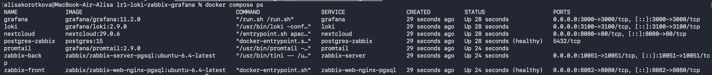

**Инициализация Nextcloud**

Открыт адрес `http://localhost:8080`, создана учетная запись. Проверка состояния приложения:

```bash
docker exec -u www-data nextcloud php occ status
```

Результат: `installed: true`, `maintenance: false`.

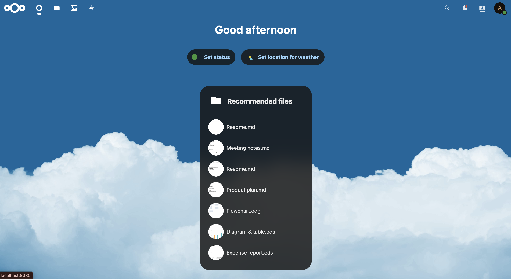

**Проверка логирования**

Проверено существование файла `/var/www/html/data/nextcloud.log`:

```bash
docker exec nextcloud ls -l /var/www/html/data/nextcloud.log
docker exec nextcloud tail -n 5 /var/www/html/data/nextcloud.log
```
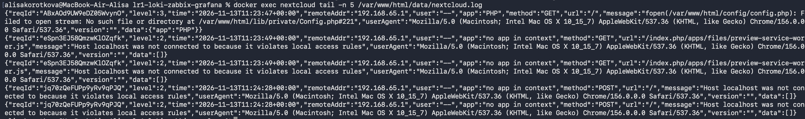

Затем проверены журналы Promtail:

```bash
docker logs promtail 2>&1 | grep 'nextcloud.log'
```

В выводе присутствовали сообщения `Seeked /opt/nc_data/nextcloud.log` и `tail routine: started`. Это подтверждает, что Promtail обнаружил файл и начал его чтение.

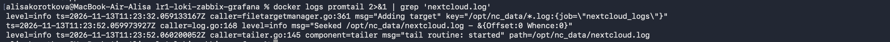

### Часть 2. Мониторинг

**Импорт шаблона**

В Zabbix (`http://localhost:8082`) выполнен вход и через _Data collection -> Templates -> Import_ загружен файл [`template.yml`](template.yml).

Шаблон _Test ping template_ содержит HTTP-проверку `http://{HOST.HOST}/status.php`. Значение поля `maintenance` преобразуется в `healthy` (режим обслуживания выключен) или `unhealthy` (включен).

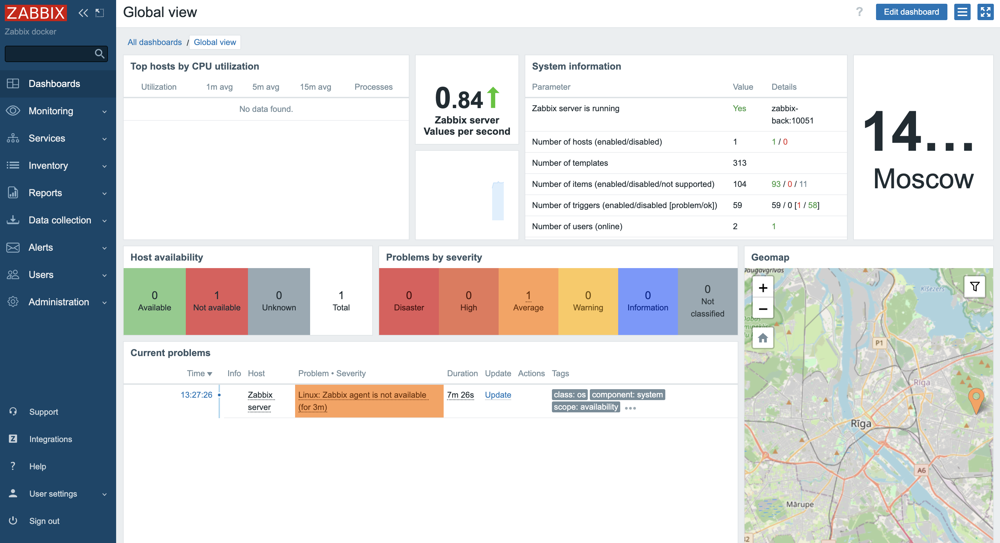
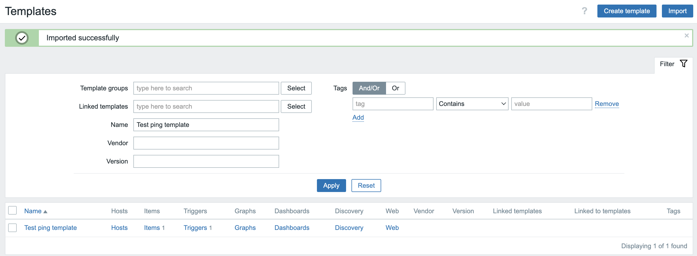
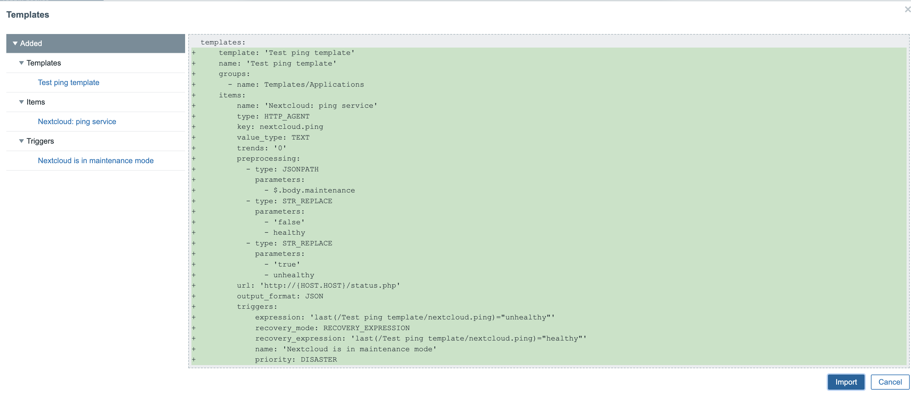


**Создание хоста Nextcloud**

Имя `nextcloud` добавлено в доверенные домены приложения:

```bash
docker exec -u www-data nextcloud php occ config:system:set trusted_domains 1 --value="nextcloud"
```

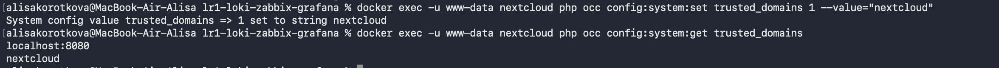

В _Data collection -> Hosts_ создан хост `nextcloud` с шаблоном _Test ping template_.

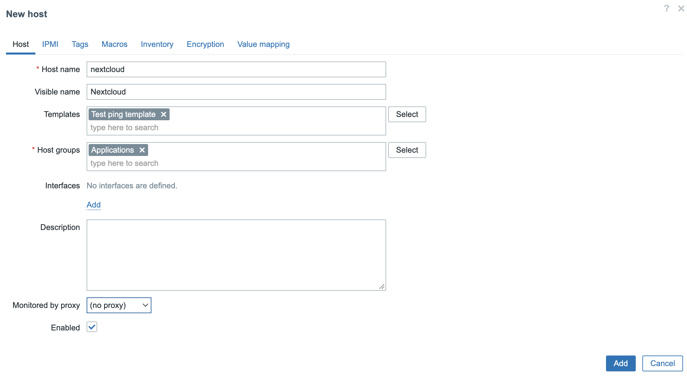
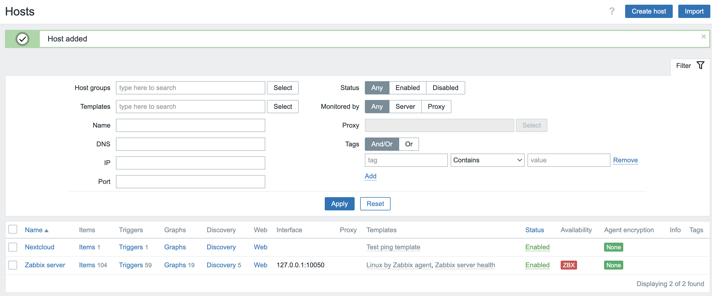

В _Monitoring -> Latest data_ элемент `Nextcloud: ping service` показал значение `healthy`.

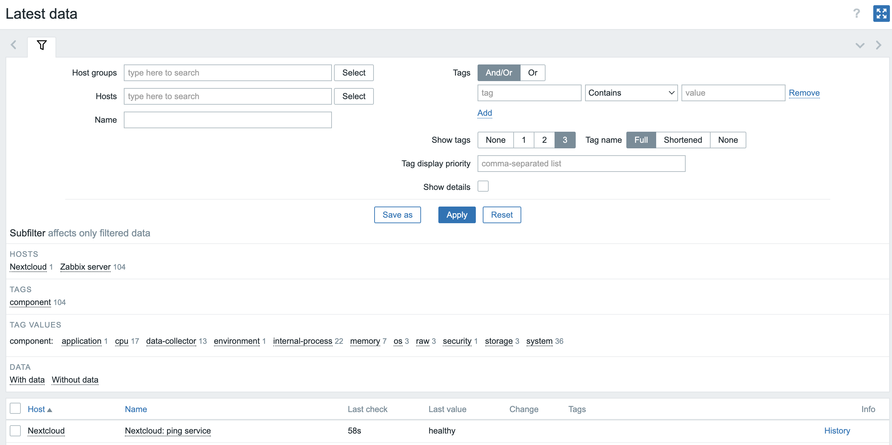

**Проверка триггера**

Для имитации изменения состояния включен режим обслуживания:

```bash
docker exec -u www-data nextcloud php occ maintenance:mode --on
```
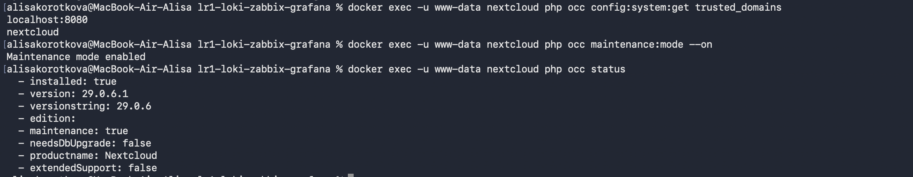

Команда `php occ status` показала `maintenance: true`. В Zabbix значение элемента изменилось на `unhealthy`, а в _Monitoring -> Problems_ появилась проблема _Nextcloud is in maintenance mode_ с уровнем _Disaster_.

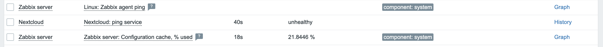
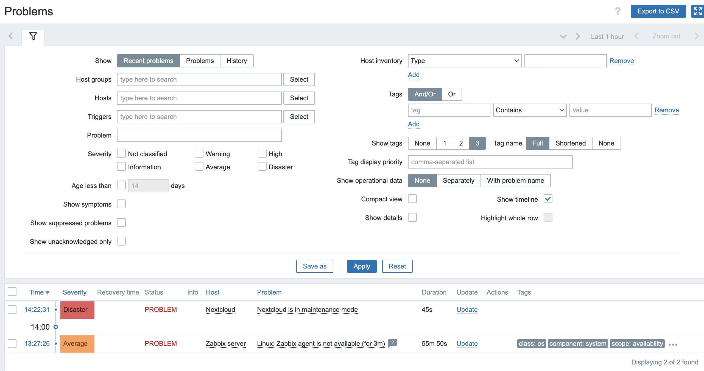

Затем режим обслуживания отключили:

```bash
docker exec -u www-data nextcloud php occ maintenance:mode --off
```
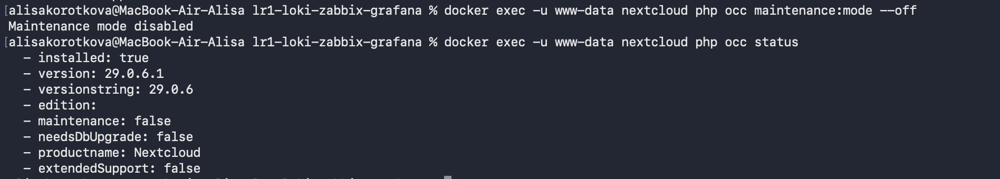

После отключения `php occ status` показала `maintenance: false`, значение элемента вернулось к `healthy`, а проблема в Zabbix автоматически получила статус _RESOLVED_.

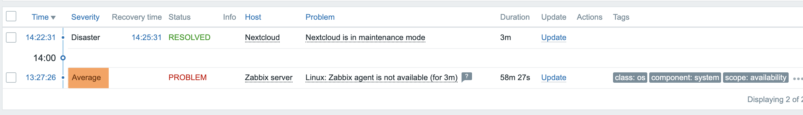
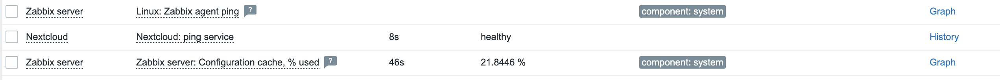

### Часть 3. Визуализация

**Настройка источников данных**

В Grafana (`http://localhost:3000`) установлен и активирован плагин _Zabbix_ (`alexanderzobnin-zabbix-app`). Затем добавлены два источника данных:

| Источник | URL внутри Docker-сети | Назначение |
|---|---|---|
| Loki | `http://loki:3100` | Просмотр логов Nextcloud |
| Zabbix | `http://zabbix-front:8080/api_jsonrpc.php` | Мониторинг состояния Nextcloud |

Оба подключения успешно прошли проверку _Save and test_.

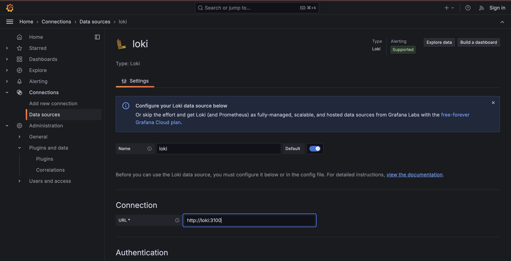
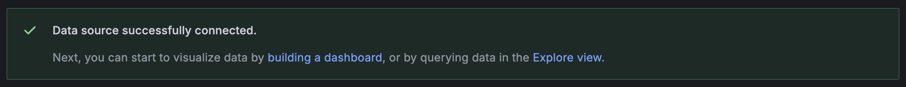

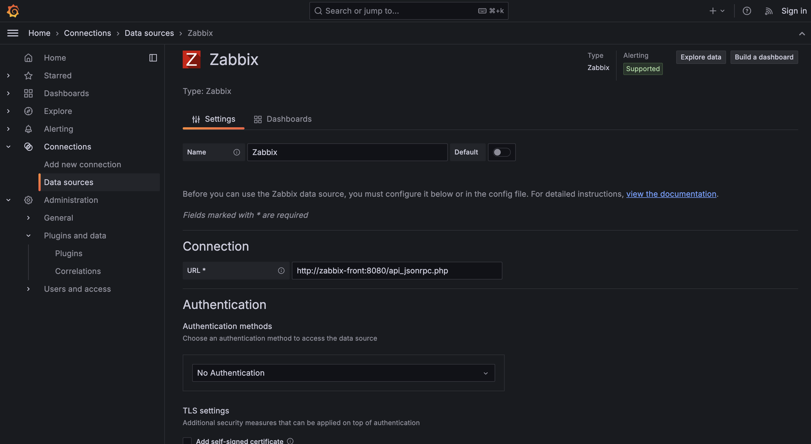
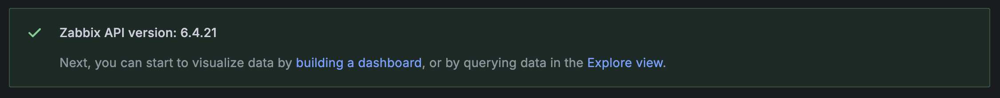

**Запросы в Explore**

Для Loki выполнен запрос LogQL:

```logql
{job="nextcloud_logs"}
```
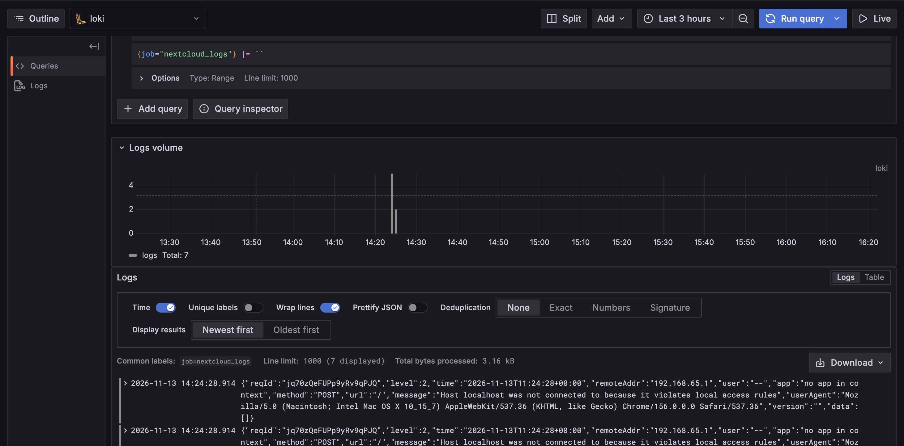

Также проверена фильтрация по содержимому сообщения:

```logql
{job="nextcloud_logs"} |= "Host localhost"
```
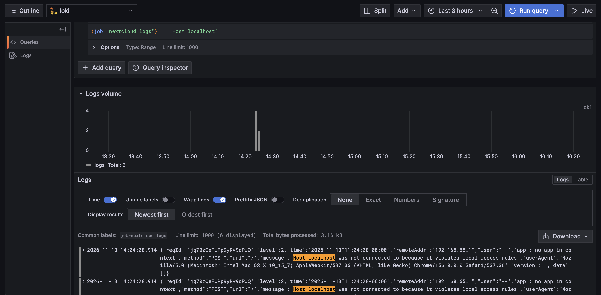

Grafana отобразила записи журнала Nextcloud.

Для Zabbix выбран тип запроса `Text`, хост Nextcloud и элемент Nextcloud: ping service. В результатах отображались текстовые значения `healthy` и `unhealthy`.

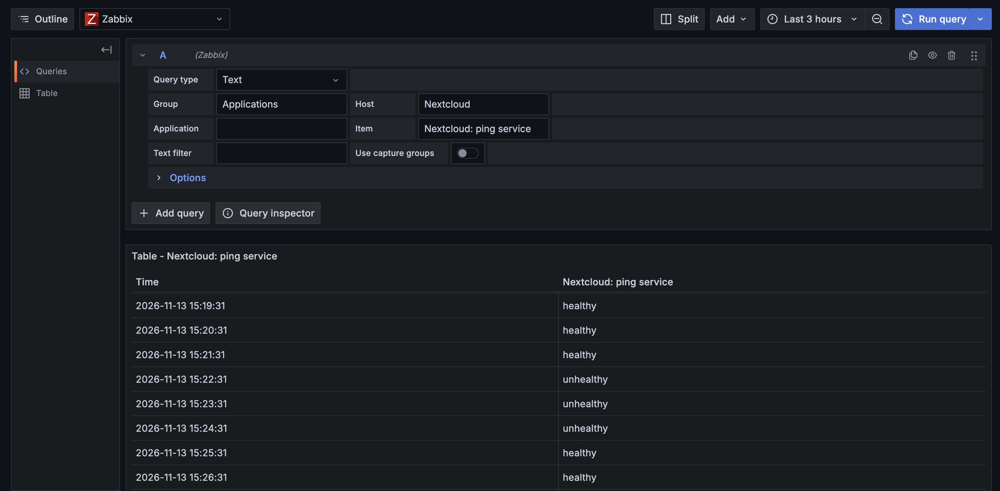

**Дашборд состояния Nextcloud**

Создан дашборд Nextcloud Monitoring - Zabbix с визуализацией _Stat_. Для значения `healthy` задана зелёная плашка с подписью _Nextcloud is: HEALTHY_, а для `unhealthy` - красная.

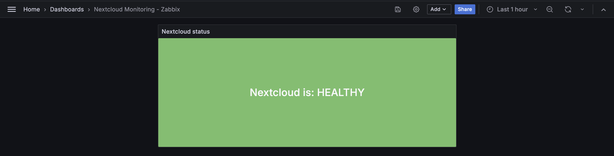
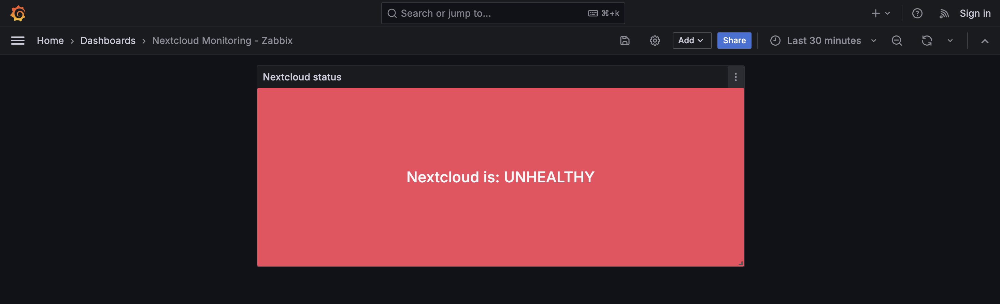

**Дашборд логов Nextcloud**

Создан дашборд _Nextcloud Logs - Loki_ с визуализацией _Logs_ и запросом `{job="nextcloud_logs"}`. Панель показывает журнал событий Nextcloud с временными метками.

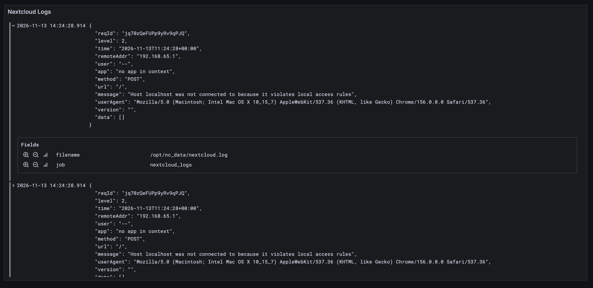

## Ответы на вопросы

### 1. Чем SLO отличается от SLA?

**SLO (Service Level Objective)** - измеримая цель качества сервиса, например доступность не ниже 99% за месяц.

**SLA (Service Level Agreement)** - соглашение между поставщиком и потребителем сервиса, где закреплены обязательства по качеству обслуживания и возможные последствия их нарушения.

SLO - целевой показатель, SLA  договоренность об уровне сервиса. SLO может входить в SLA.

### 2. Чем отличается инкрементальный бэкап от дифференциального?

**Инкрементальный бэкап** сохраняет изменения с момента последнего резервного копирования (полного или инкрементального). Для восстановления обычно нужны полный бэкап и вся последовательность последующих инкрементальных копий.

**Дифференциальный бэкап** сохраняет изменения с момента последнего полного резервного копирования. Для восстановления нужны полный бэкап и последняя дифференциальная копия.

Инкрементальные копии обычно меньше, но восстановление требует цепочки копий; дифференциальная копия может быть больше, зато восстановление проще.

### 3. В чем разница между мониторингом и observability?

**Мониторинг** отслеживает заранее выбранные показатели и события, чтобы обнаруживать известные проблемы, например переход Nextcloud в режим обслуживания.

**Observability (наблюдаемость)** - возможность понять внутреннее состояние системы по ее внешним данным (метрикам, логам, трассировкам и другим сигналам), в том числе при расследовании неожиданных проблем.

Мониторинг помогает понять, что пошло не так; observability помогает разобраться, почему это произошло. Мониторинг - часть практик наблюдаемости.

## Вывод

В ходе лабораторной работы в Docker Compose развернут тестовый Nextcloud и настроен сбор его логов через Promtail и Loki. С помощью Zabbix организован мониторинг состояния приложения и проверена работа триггера при включении и выключении режима обслуживания. В Grafana подключены оба источника данных, выполнены запросы и созданы дашборды для отображения текущего состояния Nextcloud и журнала событий.
